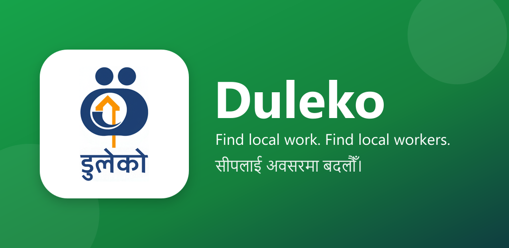
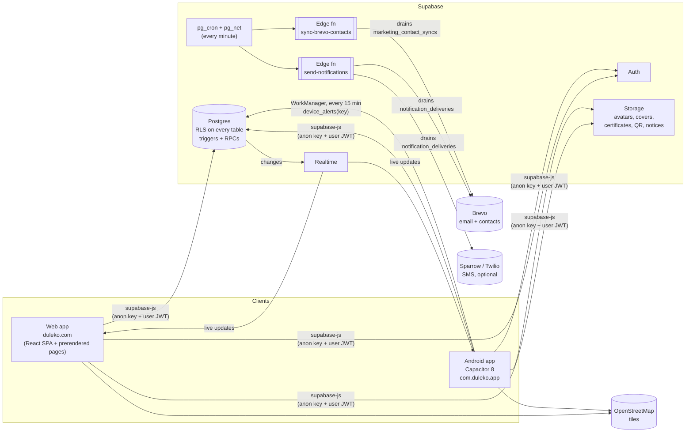
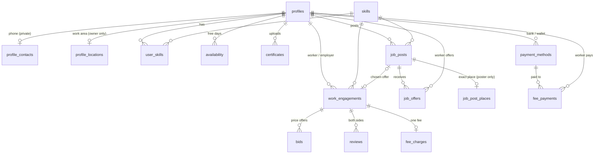
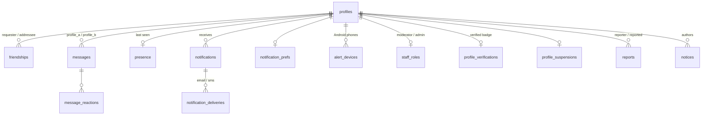
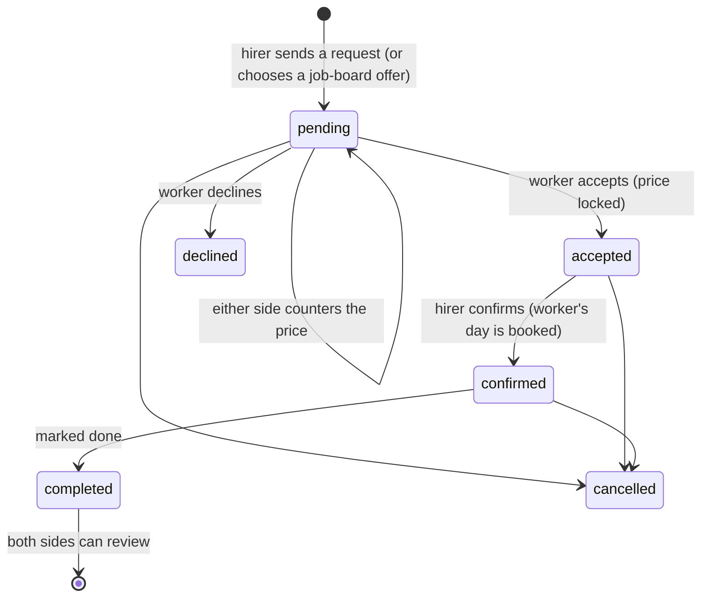
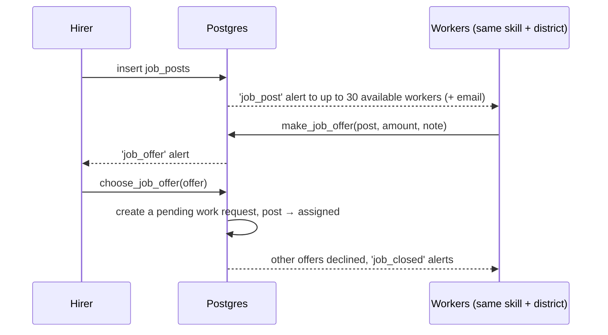
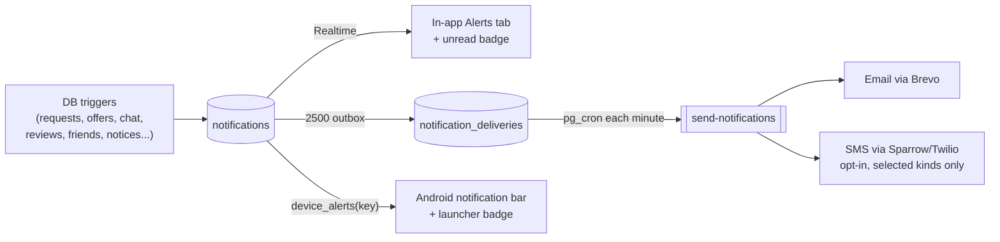

<div align="center">



# Duleko · डुलेको

**Find skilled people near you in Nepal, or get found for what you do.**

A bilingual (English / नेपाली) local skills marketplace. Workers list what they can do and where
they are. People who need work find them or post a job. Both sides agree a price, and both rate
each other afterwards. Built for Kapilvastu first, mobile-first, and designed to run on free tiers.

[](https://www.duleko.com)
[](https://play.google.com/store/apps/details?id=com.duleko.app)

-0f172a?style=flat-square&logo=android)


[Features](#features) · [Architecture](#architecture) · [Data model](#data-model) · [API surface](#api-surface) · [Quick start](#quick-start) · [Migrations](#database-and-migrations) · [Android](#android-app) · [Troubleshooting](#troubleshooting)

</div>

---

## At a glance

<table>
<tr>
<td align="center"><b>33</b><br/><sub>Postgres tables</sub></td>
<td align="center"><b>59</b><br/><sub>migrations</sub></td>
<td align="center"><b>93</b><br/><sub>SQL functions</sub></td>
<td align="center"><b>65</b><br/><sub>RLS policies</sub></td>
<td align="center"><b>46</b><br/><sub>triggers</sub></td>
<td align="center"><b>2</b><br/><sub>edge functions</sub></td>
</tr>
<tr>
<td align="center"><b>1,331</b><br/><sub>strings in EN + NE</sub></td>
<td align="center"><b>31</b><br/><sub>skills in 3 groups</sub></td>
<td align="center"><b>77</b><br/><sub>districts</sub></td>
<td align="center"><b>36 + 2</b><br/><sub>banks + wallets</sub></td>
<td align="center"><b>27 / 30</b><br/><sub>routes lazy-loaded</sub></td>
<td align="center"><b>15</b><br/><sub>prerendered pages</sub></td>
</tr>
</table>

<sub>About 33k lines of TypeScript in 142 files, 6.5k lines of SQL, and 465 lines of Java for the
Android phone alerts. Counted on 11 Oct 2026.</sub>

---

## Contents

- [Features](#features)
- [Tech stack](#tech-stack)
- [Architecture](#architecture)
- [Data model](#data-model)
- [API surface](#api-surface)
- [Quick start](#quick-start)
- [Project layout](#project-layout)
- [Database and migrations](#database-and-migrations)
- [How the core flows work](#how-the-core-flows-work)
- [Privacy and security model](#privacy-and-security-model)
- [Notifications: in-app, email, SMS, phone](#notifications-in-app-email-sms-phone)
- [Languages and dates](#languages-and-dates)
- [Performance](#performance)
- [Android app](#android-app)
- [Website and SEO](#website-and-seo)
- [Deployment and release checklist](#deployment-and-release-checklist)
- [Troubleshooting](#troubleshooting)
- [Scripts](#scripts) · [Running costs](#running-costs) · [Testing](#testing) · [Conventions](#conventions)

---

## Features

Everyone has one profile. There are no separate worker and employer accounts: add a skill and
you can be found as a worker, and anyone can hire anyone.

**For workers:** list your skills, area and free days, get found by skill and place or answer
jobs people post, agree a price directly, and build a reputation from ratings.

**For people who need work done:** search workers by skill and place, or post a job and let
workers come to you. Agree a price, get the work done, then rate each other.

| | Feature | Details |
|---|---|---|
| 📱 | **Join with a mobile number** | Create an account and sign in with a Nepali mobile number and a 6-digit PIN. No SMS code for now. Email + password and Google sign-in still work for everyone who joined that way. |
| 🔎 | **Search and browse** | Typo-tolerant search (`pg_trgm`) across names, skills and places, sorted by distance. 31 skills in three groups: *Trades & Local Services*, *Professional & Skilled Services*, *Personal & Everyday Services*. Guests can browse without an account. |
| 🗺️ | **Map** | Leaflet + OpenStreetMap with clustered pins, on Home and at `/map`. Signed-in members see people at the middle of their ~1 km square (a shop or workshop at its own spot). Guests see only how many people are in each ~5 km area. Each person's place is a work area they picked once on a map, never their live GPS. Your own blue dot stays on your phone. |
| 📋 | **Job board** | `/jobs`: post what you need done (skill, place, day, optional budget). Up to 30 available workers with that skill in that district are alerted. Workers send offers, and you pick one. |
| 🤝 | **Work requests and price negotiation** | Send a worker a request and go back and forth on price. Whoever didn't make the latest offer is the one who can accept it or counter it. |
| 🧰 | **My Work** | `/work` is your hub, split into *Work I do* and *Work I gave*. Each has Active ("Needs you" first), offers or posts, and History. |
| 📅 | **Availability calendar** | Workers mark free days. Confirming a job books the day. |
| ⭐ | **Reviews** | One review per person per job. A trigger keeps each profile's rating in step with its reviews. |
| 💬 | **Chat** | Realtime 1:1 chat with replies, edits, reactions, typing and online presence. Messages containing phone numbers are rejected. |
| 👥 | **Friends** | Friend requests. Friends can always chat and call. |
| 💳 | **Payment details** | Bank accounts at Nepal's 20 commercial and 16 development banks (with official logos and payment QR), or eSewa / Khalti wallets. Only the other side of a job and people allowed to call you can see them. |
| 🧾 | **Duleko's monthly fee** | A marginal fee: 5% of the first Rs 5,000, 4% from Rs 5,000 to Rs 20,000, 3% above. It applies to jobs requested from 1 Mangsir 2083 (17 Nov 2026), and each worker's first 5 such jobs are free. Fees are billed per Nepali month and due by the 15th. Duleko never moves money itself. |
| 🪪 | **Membership ID and Professional ID card** | Every member gets a permanent `DLK-26AA0001`-style number and a downloadable ID card with a QR code. |
| ✅ | **Staff tools** | Moderators verify profiles and handle reports. Admins also suspend users and confirm fee payments. A notice board (`/notices`) sends staff announcements to every member. |
| 🔔 | **Alerts everywhere** | In-app (Realtime), email (Brevo), optional SMS, and Android phone alerts with no Firebase. |
| 🌐 | **Bilingual, Nepali-first** | Every string is in English and Nepali. Dates show in **Bikram Sambat (BS)** by default, with AD as an option, and are always stored as AD. |
| 🌗 | **Light / dark / system theme** | Applied before first paint, so dark-mode users never see a white flash. |
| 🗑️ | **Delete my account** | One call deletes the account, everything that cascades from it, and its uploaded files. |

---

## Tech stack

| Layer | Choice |
|---|---|
| UI | **React 19**, **TypeScript 5.6**, **Tailwind CSS v4** (`@tailwindcss/vite`), `lucide-react` icons |
| Routing and data | **TanStack Router** (code-based route tree in `src/router.tsx`), **TanStack Query** |
| Forms | `react-hook-form` + `zod` |
| Maps | **Leaflet 1.9** + `leaflet.markercluster`, OpenStreetMap tiles |
| Backend | **Supabase**: Postgres, Auth (mobile number + PIN, email + password with emailed codes, Google sign-in), Storage, Realtime |
| Server logic | Postgres functions and triggers (`SECURITY DEFINER` where needed), RLS on every table, `pg_trgm`, `pg_cron`, `pg_net`, Vault |
| Edge functions | Deno: `send-notifications` (email/SMS outbox), `sync-brevo-contacts` (marketing list) |
| Email / SMS | Brevo (email). Sparrow SMS or Twilio (optional) |
| Mobile | **Capacitor 8** Android app (`com.duleko.app`), with a native WorkManager job for phone alerts |
| Build and hosting | **Vite 6**, a post-build SEO prerender script, **Vercel** |

---

## Architecture



**Design principles**

- **The database is the source of truth for rules.** Status changes, who may accept or confirm,
  who may see a phone number, fee amounts and alert fan-out are all enforced by Postgres
  triggers, RLS policies and RPCs, not just the UI. People still run older Android builds, so
  the server can't rely on any particular client.
- **The anon key is public by design.** Row Level Security protects every table, not key secrecy.
- **Outboxes, not side effects.** Triggers write rows (`notification_deliveries`,
  `marketing_contact_syncs`), and edge functions drain them. If a provider is down, the rows wait
  and are retried (`requeue_stuck_deliveries()`), so nothing is lost and nothing blocks a write.
- **Free-tier first.** Everything fits Supabase's and Vercel's free plans. The one paid extra
  (SMS) is off by default.

---

## Data model

33 tables, all in `public`, all with RLS. Every member's data hangs off `profiles`, and deleting
the auth user cascades through all of it.

### People and work



### Social, alerts and staff



<details>
<summary><b>Every table and what it holds</b></summary>

| Table | Holds |
|---|---|
| `profiles` | The public profile: name, photo, cover, about, place, rating, membership number, `public_slug`, `call_permission` |
| `profile_contacts` | Phone numbers, behind `can_call()` |
| `profile_locations` | The work area someone picked on a map, and `is_shop`. Readable only by the owner |
| `skills`, `user_skills` | The skills catalogue (bilingual, categorised) and who offers what |
| `availability` | Workers' free and booked days |
| `certificates` | Uploaded certificates shown on profiles |
| `work_engagements` | A work request and its status (`pending` → `accepted` → `confirmed` → `completed`) |
| `bids` | The price negotiation on a pending request |
| `reviews` | One per reviewer per job, which feeds `profiles.rating` |
| `job_posts`, `job_offers` | The job board and workers' offers |
| `job_post_places` | A post's exact place and pin, readable only by the poster. The chosen worker gets them through the work request |
| `friendships` | Requests and accepted friends |
| `messages`, `message_reactions` | 1:1 chat |
| `presence` | Last seen, for "online" and for holding back chat emails |
| `notifications` | Every in-app alert, in both languages |
| `notification_deliveries` | Email/SMS outbox drained by `send-notifications` |
| `notification_prefs` | Per-member email (on by default) and SMS (off by default) switches |
| `alert_devices` | Android phones registered for phone alerts (hashed device key) |
| `notices` | Staff notice board posts |
| `payment_methods` | Members' and Duleko's own bank / eSewa / Khalti accounts |
| `fee_charges`, `fee_payments` | Duleko's fee per completed job, and payments against them |
| `bs_months` | Bikram Sambat month boundaries used for billing |
| `staff_roles`, `profile_verifications`, `profile_suspensions`, `reports` | Moderation |
| `welcome_senders` | Which official accounts send the welcome chat message, and its text |
| `member_number_counters` | Running numbers for membership IDs, per sign-up year |
| `marketing_contact_syncs` | Outbox for the Brevo contact list |
| `app_settings` | Settings you can edit without a deploy (`email_daily_limit`, `sms_kinds`, welcome text ...) |

</details>

---

## API surface

The client talks to Supabase three ways: table reads and writes under RLS, RPCs for anything
that needs a rule or touches several rows, and Realtime channels. All of it goes through
[`src/lib/queries.ts`](src/lib/queries.ts) and a few hooks.

### RPCs called by the app

| RPC | Who | What it does |
|---|---|---|
| `phone_account_exists` | everyone | Whether a mobile number is already on an account, checked before sign-up. Says only yes or no |
| `search_workers` | everyone | Fuzzy, skill-aware search. Distances (whole km, from ~1 km squares) for members only |
| `skill_counts` | everyone | How many workers offer each skill (Home grid) |
| `map_people` | members | People inside a map bounding box, at the middle of their ~1 km square (shops exact) |
| `map_area_counts` | everyone | How many people are in each ~5 km square, for guests' map |
| `engagement_places` | the two people in a job | The job post's exact pin while the request is live, the other person's work area once accepted |
| `make_job_offer` / `withdraw_job_offer` | workers | Offer a price on a job post, or take the offer back |
| `choose_job_offer` | post owner | Turn an offer into a work request and decline the rest |
| `close_job_post` | post owner | Close a post without choosing anyone |
| `fee_account` | member / staff | Your own fees, or (for staff) any worker's |
| `fee_overview` | staff | Totals, and every worker with fees, most owed first |
| `register_alert_device` / `unregister_alert_device` | Android | Link or unlink a phone's alert key |
| `suspend_profile` / `unsuspend_profile` | admins | Suspend or restore a member |
| `delete_my_account` | member | Delete your own account and files |

The Android background job also calls `device_alerts(key)` directly from Java.

### Server-side helpers worth knowing

`current_profile_id()` · `can_call()` · `can_chat_with()` · `is_staff()` · `is_admin_or_above()` ·
`is_technical_admin()` · `is_profile_suspended()` · `duleko_fee_for()` · `area_coord()` ·
`public_point()` · `km_between()` · `requeue_stuck_deliveries()` · `deliver_welcome()`

### Realtime channels

| Channel | Listens to | Used by |
|---|---|---|
| `notifications:<profile>` | `notifications` inserts | Alerts screen |
| `notifications-badge:<profile>` | `notifications` | Unread badge in the bottom nav |
| `conversations:<profile>` | `messages` | Chat list |
| `messages:<pair>` | `messages`, `message_reactions` | An open chat |
| `typing:<profile>` | broadcast | "typing…" indicator |

### App error codes

RPCs raise short codes that the UI translates. Examples: `JOB_NOT_OPEN`,
`JOB_OFFER_NOT_PENDING`, and the transition trigger's `Invalid status change: <from> -> <to>`.

---

## Quick start

### Prerequisites

- **Node.js 20+**
- A **Supabase** project (region: *Southeast Asia (Singapore)*, the closest to Nepal)
- Optional: **Android Studio** for the Android app, and the **Supabase CLI** for edge functions

### 1. Clone and install

```bash
git clone https://github.com/DulekoNepal/Duleko.git
```

```bash
cd Duleko && npm install
```

### 2. Configure

```bash
cp .env.example .env.local
```

| Variable | Required | What it is |
|---|---|---|
| `VITE_SUPABASE_URL` | ✅ | Supabase → Project Settings → API → Project URL |
| `VITE_SUPABASE_ANON_KEY` | ✅ | The `anon` public key from the same page |
| `VITE_SITE_URL` | – | The canonical address used in shared profile links, e.g. `https://duleko.com`. Without it, links use whatever host the app is open on. |

If `.env.local` is missing, the app shows a setup screen instead of a blank page.

Only the anon key belongs in the frontend. Never put the `service_role` key in a `VITE_`
variable or commit it.

### 3. Create the database

Run every file in [`supabase/migrations/`](supabase/migrations) in the Supabase **SQL editor**,
**in filename order**. Read [Database and migrations](#database-and-migrations) first: some
files send a one-time message to every member.

### 4. Run

```bash
npm run dev
```

The app opens at <http://localhost:5173>.

---

## Project layout

```text
src/
  main.tsx, App.tsx           Entry, providers, theme
  router.tsx                  The whole route tree (TanStack Router)
  routes/                     One file per screen
    HomeScreen, SearchScreen, WorkerScreen, MapScreen
    JobsScreen                Job board: browse and post
    WorkScreen                My Work: your jobs, offers, posts, history
    ChatsScreen, ChatScreen, FriendsScreen, NotificationsScreen
    ProfileScreen             Thin shell, tabs live in components/duleko/profile
    FeesScreen, StaffFeesScreen, ModerationScreen, NoticesScreen
    AuthScreen, OnboardingScreen
    site/                     Public website pages (landing, about, mission, safety, terms...)
  components/
    duleko/                   Domain components (worker cards, dialogs, calendar, chat, layout)
      jobs/                   Job board parts, post-a-job dialog, My Work lists
      map/                    DulekoMap (Leaflet), HomeMapCard, use-map-view
      payments/               Bank/wallet cards, logos, forms, fee reminders
      profile/                Profile tabs: overview, calendar, payments, settings
      site/                   Website header, footer, team, skills catalogue
    ui/                       Small primitives (button, dialog, field, segmented, switch...)
  hooks/                      Session, guest mode, presence, typing, location, phone alerts, fees
  lib/
    queries.ts                Every Supabase call in the app
    types.ts                  Domain types
    i18n.tsx (+ i18n-*.ts)    Every user-facing string, EN + NE, split by area
    bs-calendar.ts            Bikram Sambat conversion (BS 2070-2090)
    work.ts                   Whose turn it is on a job (stepOf)
    fees.ts, banks.ts         Fee estimates and Nepal's banks/wallets
    nepal.ts                  Provinces, all 77 districts, local bodies
    geolocation.ts, geocode.ts, native-android.ts, phone-alerts.ts, seo.ts, theme.ts ...
supabase/
  migrations/                 The database, one numbered file per change
  functions/                  Edge functions: send-notifications, sync-brevo-contacts
android/                      Capacitor Android project (+ PhoneAlertsWorker/Plugin in Java)
scripts/                      seo-build, seo-content, shrink-existing-photos
docs/                         Blueprint, build roadmap, tech-stack notes, manual test script
public/                       Icons, manifest, robots.txt, sitemap.xml (written by the build)
store-assets/, assets/        Play Store graphics, app icon and splash sources
```

### Routes

| App | Website (public, prerendered) | Staff |
|---|---|---|
| `/home` `/search` `/map` | `/` (landing) | `/moderation` |
| `/worker/$workerId` | `/about` `/about/$slug` | `/staff/fees` |
| `/jobs` `/jobs/$jobId` | `/mission` `/motivation` | `/notices` (publish) |
| `/work` | `/individuals` `/businesses` `/partners` | |
| `/chats` `/chat/$otherId` `/friends` | `/safety` `/privacy` `/terms` | |
| `/notifications` `/notices` `/notices/$noticeId` | `/registration-policy` | |
| `/profile` `/fees` `/welcome` | | |

---

## Database and migrations

The whole backend is the SQL in [`supabase/migrations/`](supabase/migrations). Each file starts
with a comment block that explains what it does and why. **Read that block before running a file.**

### ⚠️ Apply by hand, in order. Never `supabase db push`.

Migrations are pasted into the Supabase **SQL editor** one at a time, in filename order:

- **Some migrations are one-time broadcasts.** They insert an alert or chat message for every
  member (for example the Play Store announcements). They skip people who already have the
  message, but `db push` would replay files the remote history doesn't know about.
- **Once a file has been run in production, never edit it.** Put any fix in a new migration.
  Files are kept exactly as they were run.
- **Apply a migration before shipping the frontend that needs it.** A pushed commit deploys
  straight to Vercel, and a missing column or RPC breaks the screens that use it.

### What's in there

| Range | Area |
|---|---|
| `0000`–`0600` | Core schema, triggers, RLS, `search_workers`, storage buckets, seed skills, status-change rules, Realtime |
| `0700`–`1200` | Custom skills, friends, live location sharing, cancellation reasons, fuzzy search (`pg_trgm`), unique phone numbers |
| `1300`–`1600`, `2700` | Chat, message alerts, rich chat (reactions, replies, edits) |
| `1700`–`2000` | Cover photos, profile fields, certificates, free schedule, early completion |
| `2100`–`2200` | Price negotiation (bids) on work requests |
| `2300` | Guest browsing (anon read of the public directory) and online presence |
| `2400`, `3700`, `4200`–`4500` | The official account's welcome notification and chat message |
| `2500`, `5200` | Notification outbox (email/SMS) and the daily email limit |
| `2600`, `4300`–`4400` | Who may chat and who may call ("Who can call me"), no phone numbers in chat |
| `2800`–`2900` | Delete my account |
| `3000` | Opaque `public_slug` for shared profile links |
| `3100`–`3200`, `5400` | Skill categories and new skills |
| `3400` | Brevo marketing-contact sync |
| `3500` | Staff roles, verification badges, suspensions, reports |
| `4000` | Location consent |
| `3600`, `4100`, `4600`–`4800`, `5500` | Announcements and one-time broadcasts |
| `4900`, `5100` | Membership ID numbers |
| `5000` | Notice board |
| `5300` | Android phone alerts without Firebase (`alert_devices`, `device_alerts`) |
| `5600`–`5700` | Payment details, Duleko's accounts, monthly fees, BS months, development banks |
| `5800` | Job board (`job_posts`, `job_offers`, offer/choose/close RPCs) |
| `5900` | Map (`map_people`), exact points moved to owner-only `profile_locations` |
| `6000` | Mobile number + PIN sign-in (`phone_account_exists`, a placeholder Send SMS hook) |
| `6100` | Map privacy: members-only people map, guest area counts, ~1 km squares, shop pins, private job places (`job_post_places`, `engagement_places`) |
| `6200` | Guest map areas named after one real district + municipality pair |

### Writing a new migration

1. Name it `20260101006300_short_name.sql`, the next free number in steps of 100.
2. Start with a `-- Duleko MVP :: 6300 :: Title` comment block saying what it does and why.
3. Make it **safe to run more than once** (`create ... if not exists`, `create or replace`,
   `drop policy if exists`, and `not exists` guards on inserts).
4. Enable RLS on every new table and write its policies in the same file.
5. If it changes a function's return shape, `drop function` first. Postgres can't
   `create or replace` a function into a different signature.

### Handy things to know

- **Skills** are rows in `skills` (`id`, `name_en`, `name_ne`, category, `sort_order`). The home
  grid, filters and pickers all read from there, so adding a skill needs no code change. Mirror
  new skills in `src/components/duleko/site/skills.ts` for the website.
- **Editable settings** (welcome message text, `email_daily_limit`, `sms_kinds` ...) live in
  `public.app_settings` and can be changed from the table editor without a deploy.
- **Staff** are rows in `staff_roles` (`moderator`, `admin`, `technical_admin`), checked by
  `is_staff()`, `is_admin_or_above()` and `is_technical_admin()`.

---

## How the core flows work

### A work request



A database trigger enforces every transition: only the worker can accept and only the hirer can
confirm. Anything else fails with `Invalid status change`. In My Work, `src/lib/work.ts`
(`stepOf`) works out whose turn it is, so the "Needs you" list is always right.

### The job board



### Fees

The database calculates every fee (`duleko_fee_for()` in `5600_payment_details_and_fees.sql`).
`src/lib/fees.ts` only shows an estimate before a job is done. Fees are grouped into Nepali
months (`bs_months`). A fee left unpaid past the 15th pauses *accepting new* requests until it
is paid or a staff member records the payment. Jobs already accepted carry on.

| Agreed price | Fee | Example |
|---|---|---|
| First Rs 5,000 | 5% | Rs 4,000 job → Rs 200 |
| Rs 5,000 – 20,000 | 4% on that part | Rs 10,000 job → Rs 250 + Rs 200 = Rs 450 |
| Above Rs 20,000 | 3% on that part | Rs 30,000 job → Rs 250 + Rs 600 + Rs 300 = Rs 1,150 |

---

## Privacy and security model

| Data | Who can read it |
|---|---|
| Public profile (name, photo, skills, rating, reviews, certificates) | Everyone, guests included |
| Phone number (`profile_contacts`) | Decided by the owner's **"Who can call me"** setting: `everyone`, `accepted_work` (default, only after an accepted job), `friends` or `nobody`. Friends can always call. |
| Payment details | The other side of an accepted, confirmed or completed job, and anyone who may call the owner |
| Work area (`profile_locations`) | **Only the owner.** It's a place picked once on a map, never tracked. Signed-in members see the middle of its ~1 km square, or the spot itself if the owner marked it as their shop or workshop. Guests see only counts per ~5 km area. Distances are whole kilometres, for members only. The other side of an accepted job can open the exact point while the job is active. |
| A job post's exact place (`job_post_places`) | The poster, and the worker they choose (on the work request). Everyone else sees the municipality, district and a ~1 km pin |
| Chats, notifications, engagements, friendships, bids | Only the people involved (`to authenticated`) |
| Staff roles, verification, suspensions | Kept in separate tables, so nobody can grant themselves a badge or role by editing their own profile |

Other safeguards:

- Shared profile links use a random `public_slug`, not the database id.
- Chat messages containing a phone number are rejected, so the call rule can't be dodged.
- Older app builds that still write `profiles.lat/lng` are caught by a trigger that moves the
  point into `profile_locations` and blanks the public columns.
- Members must be 18 or older.
- A PIN has only a million possibilities and there's no SMS check yet, so sign-up refuses easy
  ones (`111111`, `123456`, `123123`) and Supabase's sign-in rate limit slows guessing. Turning
  on SMS codes or CAPTCHA would make guessing harder still.
- Photos are resized on the device (`src/lib/image.ts`) and stored as WebP with long cache headers.
- Android release signing (`*.jks`, `keystore.properties`) and all `.env*` files are gitignored.
  The service-role key is only ever read from the environment (scripts) or Vault (cron).

**Found a security issue?** Please report it privately to dulekonepal@gmail.com rather than
opening a public issue.

---

## Notifications: in-app, email, SMS, phone



**Alert kinds** (`notifications.kind`):

| Group | Kinds |
|---|---|
| Work requests | `request` `accepted` `declined` `confirmed` `completed` `cancelled` `review` |
| Job board | `job_post` `job_offer` `job_closed` |
| People | `friend_request` `friend_accepted` `message` |
| Duleko | `welcome` `verified` `verify_reminder` `announcement` `notice` |
| Fees | `fee_payment` `fee_review` |

- **Email** is on by default. Chat emails only go out when the person hasn't been seen for three
  minutes, at most one per sender per fifteen minutes. Once the day's Brevo allowance is used
  (`email_daily_limit`, default 280 of the free plan's 300), emails are marked `skipped`.
  In-app alerts always arrive.
- **SMS** is opt-in per user and limited to the kinds in `app_settings.sms_kinds`, because each
  text costs money. Leave `SMS_PROVIDER` unset and SMS stays off.
- **Phone alerts (Android, no Firebase).** Each phone registers a random device key
  (`register_alert_device`). The native `PhoneAlertsWorker` (WorkManager) then calls
  `device_alerts(key)` every 15 minutes, Android's shortest interval, and shortly after the app
  is closed. It shows new messages, requests and notices, and sets the launcher badge.

<details>
<summary><b>Setting up the edge functions and cron</b></summary>

```bash
supabase functions deploy send-notifications
supabase functions deploy sync-brevo-contacts

# Email (Brevo)
supabase secrets set BREVO_API_KEY=xkeysib-xxx
supabase secrets set NOTIFY_EMAIL_FROM="Duleko <no-reply@duleko.com>"
supabase secrets set SITE_URL=https://www.duleko.com
supabase secrets set BREVO_LIST_ID=7      # marketing list for sync-brevo-contacts

# SMS (optional, pick one)
supabase secrets set SMS_PROVIDER=sparrow SPARROW_TOKEN=xxx SPARROW_FROM=Duleko
supabase secrets set SMS_PROVIDER=twilio TWILIO_ACCOUNT_SID=ACxxx TWILIO_AUTH_TOKEN=xxx TWILIO_FROM=+1xxx
```

Keep the function URL and service key in **Vault**, never in a migration, then schedule the drain:

```sql
select vault.create_secret('https://<ref>.supabase.co/functions/v1/send-notifications', 'notify_function_url');
select vault.create_secret('<service_role key>', 'notify_service_key');

create extension if not exists pg_cron;
create extension if not exists pg_net;

select cron.schedule('drain-notification-outbox', '* * * * *', $cron$
  select public.requeue_stuck_deliveries();
  select net.http_post(
    url     := (select decrypted_secret from vault.decrypted_secrets where name = 'notify_function_url'),
    headers := jsonb_build_object(
                 'Content-Type', 'application/json',
                 'Authorization', 'Bearer ' || (select decrypted_secret from vault.decrypted_secrets
                                                 where name = 'notify_service_key')),
    body    := '{}'::jsonb
  );
$cron$);
```

The Brevo contact sync uses the same pattern (`brevo_sync_function_url`,
`drain-marketing-contact-syncs`). See the comment block in `3400_brevo_contact_sync.sql`.

To check the outbox: `select status, count(*) from public.notification_deliveries group by 1;`.
Failed rows have the provider's own message in `last_error`.

</details>

---

## Languages and dates

Every string is a tuple of `[English, नेपाली]`. The core table is in `src/lib/i18n.tsx`, and each
area has its own file (`i18n-site.ts`, `i18n-jobs.ts`, `i18n-work.ts`, `i18n-profile.ts`,
`i18n-payments.ts`) merged into the same table.

```ts
// src/lib/i18n-jobs.ts
export const jobStrings = {
  homeLocationAll: ["All Nepal", "सम्पूर्ण नेपाल"],
  // ...
};

// in a component
const { t } = useI18n();
<h1>{t("jobsTitle")}</h1>
```

Keys are type-checked, so a missing or misspelt key fails the build. Alert text in the database
is also stored in both languages (`title_en`, `title_ne`, `body_en`, `body_ne`).

**Dates.** Nepal uses Bikram Sambat, so Duleko does too. `src/lib/bs-calendar.ts` converts BS
2070–2090 (April 2013 to April 2034) using the same month table as `public.bs_months`. Dates are
always stored and sent as AD day keys (`2026-10-10`). Only what people read changes, and
Profile → Settings has an English (AD) option.

---

## Performance

- **Code splitting:** 27 of 30 routes load with `lazyRouteComponent`. Only Home and the landing
  page load up front.
- **Caching:** Vite's hashed `/assets/*` are served `immutable` for a year, and profile photos
  get long cache headers too.
- **Small photos:** images are resized on the phone before upload and stored as WebP
  (`src/lib/image.ts`). Older full-size uploads were backfilled with
  `scripts/shrink-existing-photos.mjs`.
- **Search in the database:** `pg_trgm` trigram matching plus `ILIKE`, with distances worked out
  in SQL. The client never downloads the directory to filter it.
- **Map by viewport:** `map_people` takes a bounding box and a limit (default 300), and pins are
  clustered with `leaflet.markercluster`.
- **No theme flash:** the saved light/dark choice is applied in `index.html` before React mounts.
- **Prerendered HTML:** public pages ship real content inside `#root`, so the first paint and
  link previews don't wait for JavaScript.

---

## Android app

The same React app wrapped with **Capacitor 8**.

| | |
|---|---|
| App id | `com.duleko.app` |
| Current version | `1.2` (versionCode `6`) |
| SDK | min 24 (Android 7.0), target and compile 36 |
| Native plugins | App, Status Bar, Splash Screen, Geolocation, Share, Clipboard, Filesystem, Badge |
| Native code | `MainActivity`, `PhoneAlertsPlugin` and `PhoneAlertsWorker` (Java) |
| Permissions | Internet, post notifications, coarse and fine location |

Native-only behaviour lives in `src/lib/native-android.ts`: the hardware back button navigates
back instead of exiting, and the status bar matches the light or dark theme.

### Release history

| Version | Code | Date | Highlights |
|---|---|---|---|
| 1.2 | 6 | 3 Oct 2026 | Phone alerts and an unread count on the app icon (no push service), Membership IDs, notice board |
| 1.1 | 5 | 2 Oct 2026 | Light/dark mode, a more compact app throughout, redesigned profiles, faster photos and pages |
| 1.0 | 4 | 20 Sep 2026 | Compact header and tab bar, fixed system-bar overlap |
| 1.0 | 3 | 19 Sep 2026 | Final 1.0 release build |

Web changes reach Android users with the next app release, while the database is shared, so
every migration has to keep older app versions working.

### Build a release

```bash
npm run build
```

```bash
npx cap sync android
```

Then open the project in Android Studio:

```bash
npx cap open android
```

Or build the bundle from the command line:

```bash
cd android && ./gradlew bundleRelease
```

Release signing reads `android/keystore.properties` (gitignored: `storeFile`, `storePassword`,
`keyAlias`, `keyPassword`). Without it the release build is unsigned, which is fine for local
testing. Bump `versionCode` and `versionName` in `android/app/build.gradle` for every Play Store
upload. App icons and the splash screen come from `assets/` through `@capacitor/assets`.

---

## Website and SEO

`duleko.com` is the same single-page app, so the public pages live in `src/routes/site/`. After
`vite build`, [`scripts/seo-build.mjs`](scripts/seo-build.mjs) writes a separate HTML file for
each public page (15 today). Each one gets:

- its own title, description, keywords, canonical URL and Open Graph / Twitter tags
- JSON-LD for the organization and its founder, the website, the app, the page and its breadcrumb
- the page's text as plain HTML inside `#root`, for crawlers and link previews that don't run JS

The script also generates `sitemap.xml` (with team photos as image entries) into both `dist/`
and `public/`, so the committed copy always matches what's deployed. Titles and descriptions are
in `src/lib/seo-pages.json`, and the page text is in `scripts/seo-content.mjs`. When a page's
content changes, bump its `lastmod`.

---

## Deployment and release checklist

Pushing to `main` deploys the web app on **Vercel**. [`vercel.json`](vercel.json) sets:

- `cleanUrls`, so `/about` serves the prerendered `about.html`
- `Cache-Control: immutable` for one year on hashed `/assets/*`
- an SPA fallback rewrite for every other route

Set `VITE_SUPABASE_URL`, `VITE_SUPABASE_ANON_KEY` and `VITE_SITE_URL` in Vercel → Settings →
Environment Variables. In Supabase → Authentication → URL Configuration, set the **Site URL**
to the production address and add it to **Redirect URLs** (Google sign-in returns there).

**Mobile number + PIN sign-in** needs two dashboard settings, after migration `6000` has run:

1. **Authentication → Auth Hooks → Add hook → Send SMS hook**: type *Postgres*, schema
   `public`, function `send_sms_hook`. The dashboard won't switch the Phone provider on without
   an SMS provider unless this hook is on. It sends nothing.
2. **Authentication → Sign In / Providers → Phone**: turn on *Enable Phone provider* and turn
   **off** *Enable phone confirmations*, so a new account works with no SMS code.

The PIN is the account's Supabase password, stored as `Duleko-PIN-` followed by the 6 digits
(`src/lib/phone-auth.ts`). That keeps it valid under any password rule set for email accounts.
To add SMS codes later, point the Send SMS hook at an SMS provider and turn confirmations on.

**Before every push to `main`**

- [ ] Every new migration the change depends on has been run in the SQL editor
- [ ] Spot-check the live database: new tables answer `200`, new RPCs aren't `PGRST202`
- [ ] `npm run build` passes (types, bundle, SEO pages, sitemap)
- [ ] Bumped `lastmod` in `seo-pages.json` for any public page whose text changed
- [ ] Nothing internal or secret is staged: the repo is public

**For a Play Store release**

- [ ] Bump `versionCode` and `versionName` in `android/app/build.gradle`
- [ ] `npm run build`, then `npx cap sync android`, then `./gradlew bundleRelease`
- [ ] Install the APK on a real phone. Check sign-in, a phone alert, location and the back button
- [ ] Upload the `.aab` in Play Console

---

## Troubleshooting

| Symptom | Likely cause | Fix |
|---|---|---|
| The app shows a setup screen | `.env.local` is missing or empty | Copy `.env.example` and fill in both `VITE_SUPABASE_*` values |
| `PGRST202 … could not find the function` | The migration that adds that RPC hasn't been run, or its arguments changed | Run the migration. Check the argument names match `queries.ts` |
| `PGRST205` / `relation … does not exist` | A table's migration hasn't been run | Run the missing migrations in order |
| `42501 permission denied for function …` | The caller isn't allowed (e.g. `fee_overview` is staff-only) | Expected for guests and members. Check `staff_roles` for staff |
| `Invalid status change: accepted -> completed` | Jobs must be confirmed before they can be completed | Confirm first. The trigger allows only the transitions in the diagram above |
| Emails stopped for the day | `email_daily_limit` was reached | Rows show `skipped`. They resume after 00:00 UTC (5:45 am in Nepal) |
| An email or SMS never arrived | The provider rejected it | `select last_error from notification_deliveries where status = 'failed'` |
| Phone alerts arrive late | Android runs background jobs at most every 15 minutes | Expected. Opening the app shows everything right away |
| "Mobile number sign-in isn't switched on yet" | The Phone provider is off, or *Enable phone confirmations* is still on | Do the two dashboard steps under [Deployment](#deployment-and-release-checklist) |
| Someone forgot their PIN | There's no SMS yet, so they can't reset it themselves | Check it's really them, then in the SQL editor: `update auth.users set encrypted_password = extensions.crypt('Duleko-PIN-' \|\| '<new PIN>', extensions.gen_salt('bf')) where phone = '977<number>';` |
| Old map pins look exact | An old app build wrote `profiles.lat/lng` | The `5900` trigger moves it into `profile_locations`. Make sure 5900 has been run |

---

## Scripts

| Command | What it does |
|---|---|
| `npm run dev` | Vite dev server at <http://localhost:5173> |
| `npm run build` | `tsc --noEmit`, then `vite build`, then the SEO prerender and sitemap |
| `npm run typecheck` | Type-check only |
| `npm run preview` | Serve the production build locally |
| `node scripts/shrink-existing-photos.mjs` | One-time backfill that resizes old full-size uploads to WebP. Dry run by default, `--apply` to write. Needs `SUPABASE_SERVICE_ROLE_KEY` in the environment only, never in a file. |

---

## Running costs

| Service | Plan | Covers |
|---|---|---|
| Supabase | Free | 500 MB database, 1 GB storage, Auth, Realtime, edge functions |
| Vercel | Free (Hobby) | Hosting, global CDN, 100 GB bandwidth |
| Brevo | Free | 300 emails a day (Duleko caps itself at 280) |
| OpenStreetMap | Free | Map tiles |
| SMS | Pay per message | About NPR 1–2 each through a Nepali gateway (Sparrow), around NPR 7 through Twilio. Off unless configured. |

Phone alerts use no push service at all, so there's no Firebase project or bill.

---

## Testing

- **Type safety:** `npm run build` fails on any type error, including a missing i18n key.
- **Manual script:** [`docs/TESTING.md`](docs/TESTING.md) walks through every flow with two
  people at once (a worker and a hirer in two browsers). Run it against the deployed URL before
  inviting new beta users.
- **SQL:** try new migrations on a throwaway Postgres (or PGlite) with the earlier files
  applied before running them in production.
- **Live checks:** after running a migration, read the new tables and call the new RPCs with
  the anon key to confirm they're live before you push the frontend.

---

## Conventions

- **Every user-facing string goes through i18n** with both English and Nepali. There are no
  hard-coded UI strings.
- **Every Supabase call goes through `src/lib/queries.ts`**, so screens never build queries inline.
- **Dates are stored as AD day keys** (`2026-10-10`) and shown in BS by default (`formatDate`).
- **Rules go in the database.** If a rule matters for safety or money, enforce it with a trigger,
  policy or RPC, and treat the UI check as a convenience.
- **Never break older app builds.** The Android app updates slowly, so schema changes must keep
  old clients working (see how `5900` handles old location writes).
- **Commit messages** describe the change for a person, e.g.
  *"Move Auto Rickshaw to Personal & Everyday Services (tracker #40)"*.

---

<div align="center">


**Made in Nepal 🇳🇵** · [duleko.com](https://www.duleko.com) · [Google Play](https://play.google.com/store/apps/details?id=com.duleko.app)

</div>
